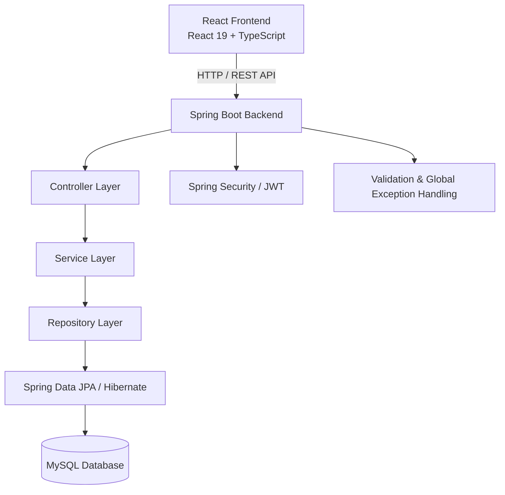

# LocalWorker

<div align="center">

### Connecting Customers with Trusted Local Professionals

A full-stack service booking platform that simplifies how customers discover local professionals, request services, and manage bookings.

<br/>

[](https://workermanagement.vercel.app/)
[](https://localworker-backend.onrender.com)
[](https://github.com/harshal-269/Worker-Management)

<br/>


</div>

---

## Overview

**LocalWorker** is a full-stack local service booking platform designed to connect customers who need everyday services with skilled professionals who provide them.

Finding reliable local service providers can be inconvenient. LocalWorker brings customers and workers together through a centralized platform where users can discover services, manage profiles, and handle service bookings.

The application provides separate experiences for customers and workers, supported by secure authentication, role-based authorization, REST APIs, and database persistence.

**The goal:** Build a practical, maintainable, and scalable full-stack application while applying real-world software engineering concepts.

## The Problem

Finding dependable local professionals often involves:

- Relying on word-of-mouth recommendations.
- Difficulty comparing available service providers.
- Managing service requests through calls and messages.
- Lack of centralized booking management.
- Limited visibility into worker profiles and services.

## The Solution

LocalWorker provides a centralized platform where:

- Customers can discover services and request bookings.
- Workers can manage their profiles and service offerings.
- Booking requests can be accepted or rejected with a reason.
- Customers can track booking information and statuses.
- Role-based access separates customer, worker, and administrator functionality.

---

## Application Preview

<div align="center">

### Customer Dashboard


<br/><br/>

### Worker Dashboard


<br/><br/>

### Authentication


<br/><br/>

### Worker Profile


</div>

---

## Key Features

### Authentication & Security

- User registration and login.
- JWT-based authentication.
- Role-based authorization.
- Google OAuth 2.0 authentication.
- Protected REST API endpoints.
- Password hashing using Spring Security.

### Customer Features

- Dedicated customer dashboard.
- Browse available services and workers.
- Submit service booking requests.
- Track booking information and statuses.
- View booking rejection reasons.

### Worker Features

- Dedicated worker dashboard.
- Worker profile management.
- Profile picture upload.
- Manage service offerings.
- Receive and manage booking requests.
- Accept or reject booking requests.
- Provide rejection reasons.

### Booking & Notifications

- Customer-to-worker booking workflow.
- Booking status management.
- Booking request handling.
- Rejection reason management.
- Booking-related notifications.

### Backend Engineering

- RESTful API development.
- Layered monolithic architecture.
- DTO-based request and response handling.
- Input validation.
- Global exception handling.
- Spring Data JPA integration.
- MySQL database persistence.

---

## Technology Stack

| Layer | Technologies |
|:--|:--|
| Frontend | React 19, TypeScript |
| Frontend Tooling | Vite |
| Backend | Java 21, Spring Boot |
| API | Spring Web, REST |
| Security | Spring Security, JWT, Google OAuth 2.0 |
| Persistence | Spring Data JPA, Hibernate |
| Database | MySQL 8 |
| Validation | Jakarta Bean Validation |
| Backend Build | Maven |
| Frontend Build | npm |
| Version Control | Git, GitHub |
| Frontend Deployment | Vercel |
| Backend Deployment | Render |

---

## System Architecture

LocalWorker follows a **layered monolithic architecture**.

The React frontend communicates with the Spring Boot backend through REST APIs. The backend separates responsibilities into controllers, services, repositories, models, DTOs, and exception-handling components.



### Backend Layer Responsibilities

| Layer | Responsibility |
|:--|:--|
| Controller | Handles HTTP requests and responses |
| Service | Contains application business logic |
| Repository | Performs database operations |
| Model | Represents application entities |
| DTO | Transfers structured request and response data |
| Exception | Handles application errors centrally |

---

## Project Structure

```text
Worker-Management/
│
├── backend/
│   ├── src/main/java/com/localworker/backend/
│   │   ├── controller/
│   │   ├── service/
│   │   ├── repository/
│   │   ├── model/
│   │   ├── dto/
│   │   ├── exception/
│   │   └── ...
│   │
│   ├── src/main/resources/
│   └── pom.xml
│
├── frontend/
│   ├── src/
│   │   ├── api/
│   │   ├── components/
│   │   ├── pages/
│   │   └── ...
│   │
│   ├── package.json
│   └── vite.config.ts
│
└── README.md
```

---

## Getting Started

Follow these instructions to run LocalWorker locally.

### Prerequisites

Make sure you have installed:

- Java 21
- Maven or the included Maven Wrapper
- Node.js and npm
- MySQL 8
- Git

### 1. Clone the Repository

```bash
git clone https://github.com/harshal-269/Worker-Management.git

cd Worker-Management
```

### 2. Configure the Database

Create the database in MySQL:

```sql
CREATE DATABASE localworker_db;
```

Configure the backend database connection using your local environment configuration.

Do not commit actual database passwords, JWT secrets, OAuth client secrets, or other sensitive credentials.

### 3. Run the Backend

Open a terminal:

```bash
cd backend
```

On Windows:

```cmd
mvnw.cmd spring-boot:run
```

On Linux/macOS:

```bash
./mvnw spring-boot:run
```

Backend default address:

`http://localhost:8080`

### 4. Run the Frontend

Open another terminal:

```bash
cd frontend

npm install

npm run dev
```

Frontend development address:

`http://localhost:5174`

The actual development port depends on the Vite configuration.

---

## API Overview

The backend exposes REST APIs for authentication, users, workers, images, services, and bookings.

### Authentication APIs

| Method | Endpoint | Description |
|:--|:--|:--|
| POST | `/api/auth/register` | Register a new user |
| POST | `/api/auth/login` | Authenticate a user |

### Other API Groups

| API Group | Responsibility |
|:--|:--|
| `/api/users` | User-related operations |
| `/api/workers` | Worker profiles and operations |
| `/api/images` | Image upload and retrieval |
| Booking APIs | Booking lifecycle management |
| Service APIs | Service-related operations |

Refer to the backend controllers for the complete endpoint list.

---

## Security

Security is an important part of LocalWorker's backend implementation.

The application incorporates:

- Spring Security for endpoint protection.
- JWT-based authentication.
- Role-based authorization.
- Password hashing.
- Request validation.
- Centralized exception handling.
- Secure configuration practices for sensitive credentials.

Production deployment should use secure secrets, HTTPS, and correctly configured OAuth redirect URLs.

---

## Deployment

LocalWorker uses separate hosting services for the frontend and backend.

| Component | Platform | Link |
|:--|:--|:--|
| Frontend | Vercel | [Live Application](https://workermanagement.vercel.app/) |
| Backend | Render | [Backend Service](https://localworker-backend.onrender.com) |
| Source Code | GitHub | [Repository](https://github.com/harshal-269/Worker-Management) |

The live application may experience availability delays depending on hosting service behavior and plan limitations.

---

## Engineering Highlights

This project demonstrates practical application of:

- Layered monolithic architecture.
- RESTful API design.
- Separation of concerns.
- DTO-based data transfer.
- JWT authentication and role-based authorization.
- Object-relational mapping using JPA and Hibernate.
- Input validation and centralized exception handling.
- Frontend-backend integration.
- File upload and retrieval.
- Git-based version control and deployment workflows.

---

## Future Enhancements

Planned improvements include:

- Complete administrator dashboard and management workflows.
- Advanced worker discovery and filtering.
- Improved reviews and ratings experience.
- Real-time booking updates and notifications.
- More comprehensive automated testing.
- Production-grade persistent file storage.
- Further performance and security improvements.

---

## Author

<div align="center">

### Harshal Darandale

**AI & Data Science Engineering Student | Full-Stack Java Developer**

[](https://github.com/harshal-269)
[](https://www.linkedin.com/in/harshal-darandale-65a5132b5/)
[](https://harshal-269.vercel.app)

<br/>

**LocalWorker — Connecting People. Empowering Local Professionals.**

Built with Java, Spring Boot, React, TypeScript and MySQL.

</div>